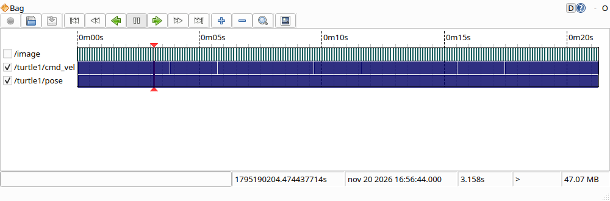

# rqt_bag

`rqt_bag` is a GUI tool for displaying and replaying ROS 2 bag files.
With it you can see the messages of a bag on a timeline, inspect their content, play the bag publishing the topics you select, and record new bags.



## Usage

```console
ros2 run rqt_bag rqt_bag [--clock] [bag ...]
```

- `bag`: a bag to open, either its directory or its `metadata.yaml` file. Several bags can be given.
- `--clock`: publish the time of the bag in the `/clock` topic while topics are being published.

`rqt_bag` is also available as a plugin of `rqt`, in the `Plugins` > `Logging` > `Bag` menu.

- **View messages**: right-click on the timeline of a topic and select a view from the `View` menu. The `Raw` view shows the fields of the message under the playhead.
- **Publish**: check the box next to the name of a topic to publish it while the bag is played. No topic is published by default.
- **Record**: start `rqt_bag` without a bag and click on the `Record Bag` button.

More views, like images and plots, are provided by the [rqt_bag_plugins](https://docs.ros.org/en/rolling/p/rqt_bag_plugins/) package.

## Documentation

The full documentation, including tutorials and the list of mouse and keyboard shortcuts, is in the [doc](https://github.com/ros-visualization/rqt_bag/tree/rolling/rqt_bag/doc) directory, and it is published at [docs.ros.org](https://docs.ros.org/en/rolling/p/rqt_bag/).
