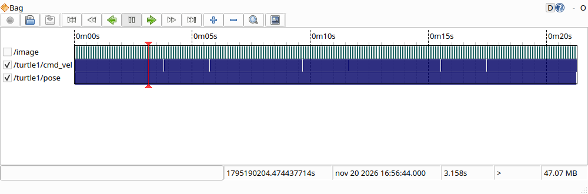
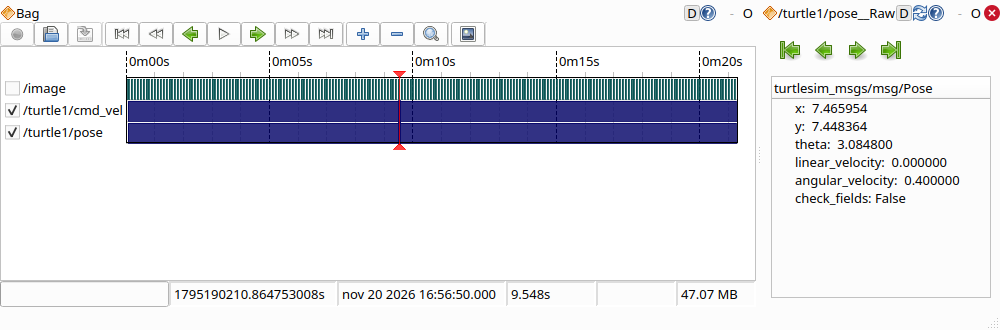

Inspecting and playing a bag
----------------------------

Overview
~~~~~~~~

This tutorial demonstrates how to open a bag with ``rqt_bag``, look at its messages and play it, publishing some of its topics.

Prerequisites
~~~~~~~~~~~~~

This tutorial assumes you have a working knowledge of ROS 2 and of `ros2 bag <https://docs.ros.org/en/rolling/Tutorials/Beginner-CLI-Tools/Recording-And-Playing-Back-Data/Recording-And-Playing-Back-Data.html>`_.

It uses the ``turtlesim`` package to generate the data.
If you already have a bag, you can skip the first step and use your bag instead.

1. Record a bag
~~~~~~~~~~~~~~~

Open a terminal and start ``turtlesim``:

.. code-block:: console

  $ ros2 run turtlesim turtlesim_node

In a second terminal, make the turtle move in a square:

.. code-block:: console

  $ ros2 run turtlesim draw_square

In a third terminal, record the velocity commands and the pose of the turtle for about 20 seconds, and then stop the recording with ``Ctrl+C``:

.. code-block:: console

  $ ros2 bag record -o my_bag --topics /turtle1/cmd_vel /turtle1/pose

Stop ``draw_square`` too, but keep ``turtlesim`` running: it is used again in the last step.

2. Open the bag
~~~~~~~~~~~~~~~

.. code-block:: console

  $ ros2 run rqt_bag rqt_bag my_bag

``rqt_bag`` shows one row for every topic of the bag, with a mark for every message.
The status bar shows the size of the bag.

3. Navigate the timeline
~~~~~~~~~~~~~~~~~~~~~~~~

* Click on the timeline to move the playhead, the red vertical line. The status bar shows its time.
* Use ``Ctrl`` and the mouse wheel, or the ``Zoom In`` and ``Zoom Out`` buttons, to zoom the timeline.
  When you zoom in, the marks of the individual messages become visible.
* Click on ``Zoom Home`` to see the whole bag again.

4. Look at the messages
~~~~~~~~~~~~~~~~~~~~~~~

Right-click on the timeline of the ``/turtle1/pose`` topic and select ``View`` and then ``Raw``.
A new panel shows the fields of the message under the playhead:

Click on a different position of the timeline, and the values change.
The buttons of the panel move the playhead exactly to the previous and to the next message of the topic.

5. Play the bag
~~~~~~~~~~~~~~~

Click on the ``Play / Pause`` button, or press ``Space``.
The playhead moves in real time, and the raw view is updated with every message.

Click on ``Fast Forward`` to double the speed, and on ``Slower / Rewind`` to halve it.
The status bar shows the current speed.

To play only a part of the bag, click and drag on the time ruler above the timeline to select a region.
The playback is then limited to the region, and it starts again from its beginning when it reaches its end.

6. Publish the topics
~~~~~~~~~~~~~~~~~~~~~

By default the messages are not published while the bag is played.
Pause the playback, and check the box next to the name of the ``/turtle1/cmd_vel`` topic.

Click on ``Go To Beginning`` and then on ``Play / Pause``: the turtle of the ``turtlesim`` window that you left running repeats the movements that were recorded.

You can confirm that the messages are being published from another terminal:

.. code-block:: console

  $ ros2 topic echo /turtle1/cmd_vel

.. note::

   Only publish the topics that the rest of the system does not produce by itself.
   In this example ``/turtle1/pose`` must not be published, because ``turtlesim`` already publishes it.
