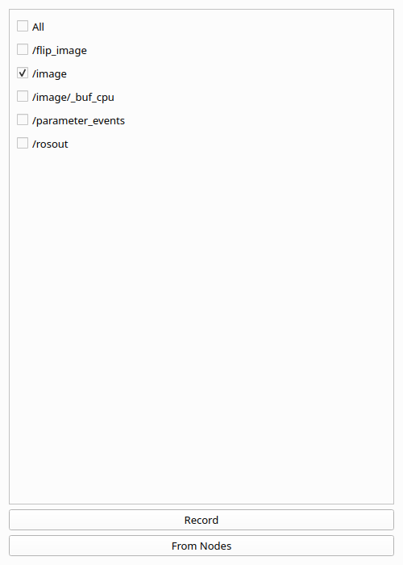
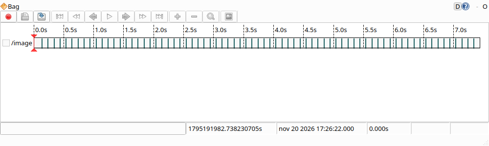

Recording a bag
---------------

Overview
~~~~~~~~

This tutorial demonstrates how to record a bag with ``rqt_bag``, selecting the topics from a list.

Prerequisites
~~~~~~~~~~~~~

This tutorial assumes you have a working knowledge of ROS 2.

It uses the ``image_tools`` package to generate the data, but any other node that publishes messages can be used instead.

1. Start a publisher
~~~~~~~~~~~~~~~~~~~~

Open a terminal and publish some images.
In burger mode, ``cam2image`` publishes synthetic images in the ``/image`` topic, so no camera is needed:

.. code-block:: console

  $ ros2 run image_tools cam2image --ros-args -p burger_mode:=true -p frequency:=10.0

2. Start rqt_bag
~~~~~~~~~~~~~~~~

In a second terminal, start ``rqt_bag`` without a bag.
Recording is not available once a bag has been loaded:

.. code-block:: console

  $ ros2 run rqt_bag rqt_bag

3. Select the topics
~~~~~~~~~~~~~~~~~~~~

Click on the ``Record Bag`` button, the first one of the toolbar.
A window lists the topics that are currently available:

Check the ``/image`` topic and click on ``Record``.

* Check ``All`` to record all the topics, including the ones that appear after the recording has started.
* Click on ``From Nodes`` to select nodes instead: the topics that they publish are checked.

4. Choose the name of the bag
~~~~~~~~~~~~~~~~~~~~~~~~~~~~~

A dialog asks for the name of the new bag, and it proposes the current date and time.
Enter ``my_recorded_bag`` and accept.

The recording starts immediately.
The messages appear on the timeline as they are recorded:

The content of the messages cannot be inspected with the views until the recording has finished and the bag is opened again.

5. Stop the recording
~~~~~~~~~~~~~~~~~~~~~

* Click on the ``Record Bag`` button to pause the recording, and click on it again to resume it.
* Click on the ``Save Bag`` button to finish the recording and close the bag.

Check the result in a terminal:

.. code-block:: console

  $ ros2 bag info my_recorded_bag

The bag can now be opened with ``rqt_bag``, or played with ``ros2 bag play``.
