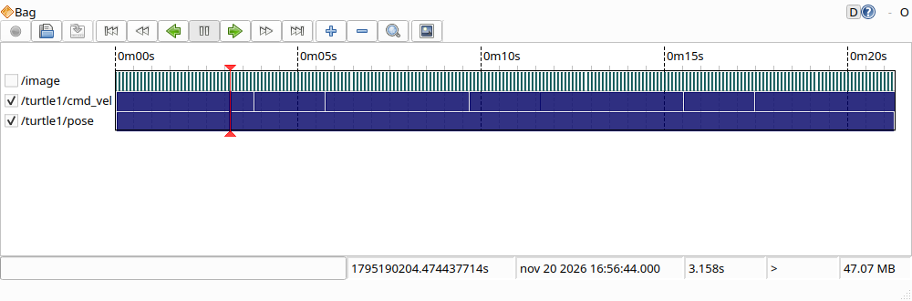
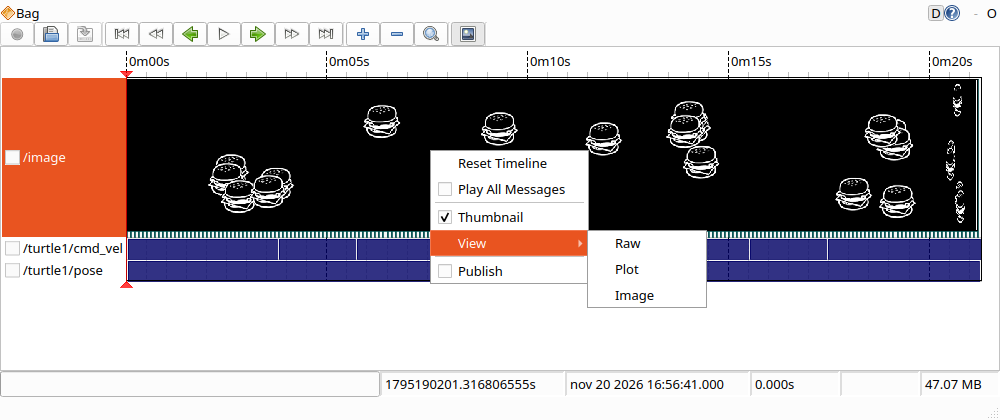
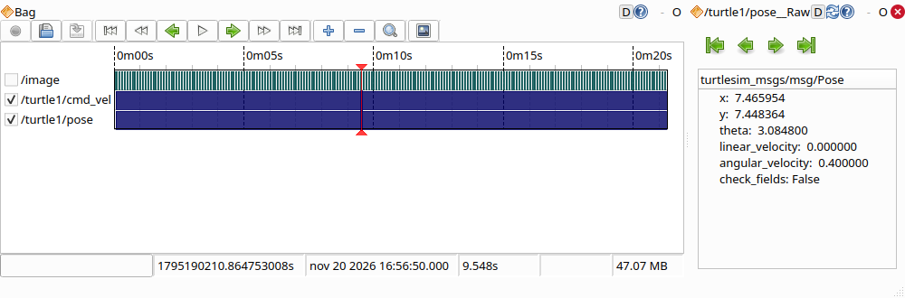

rqt_bag
=======

``rqt_bag`` is a GUI tool for displaying and replaying ROS 2 bag files.
With it you can:

* see the messages of every topic of a bag on a timeline,
* inspect the content of the messages,
* play the bag, publishing the topics you select,
* record a new bag from the topics that are being published.

.. toctree::
   :maxdepth: 2

   self
   tutorials
   references
   Package information </standards>

1. Starting rqt_bag
-------------------

Run it as a standalone application, optionally with the bags to open:

.. code-block:: console

   $ ros2 run rqt_bag rqt_bag [--clock] [bag ...]

``bag``
  A bag to open: the directory of the bag, or its ``metadata.yaml`` file.
  Several bags can be given, and they are shown together on the same timeline.

``--clock``
  Publish the time of the bag in the ``/clock`` topic while topics are being published, see `5. Publishing`_.

``rqt_bag`` is also available as a plugin of ``rqt``, in the ``Plugins`` > ``Logging`` > ``Bag`` menu.

Bags are read with ``rosbag2``, so all the storage formats that are installed (like MCAP and SQLite3) are supported, including bags recorded with per-message compression.

To show or publish the messages of a topic, the package that defines its message type must be installed and sourced in the terminal where ``rqt_bag`` is started.
The topics whose type is not available are still listed on the timeline.

2. The main window
------------------

2.1 Toolbar
~~~~~~~~~~~

From left to right, the buttons of the toolbar are:

.. list-table::
   :header-rows: 1
   :widths: 25 75

   * - Button
     - Description
   * - Record Bag
     - Record a new bag, see `6. Recording`_. Not available once a bag has been loaded.
   * - Load Bag
     - Open a bag. Loading another bag adds it to the timeline.
   * - Save Bag
     - Stop the recording. Saving a region of a loaded bag is currently not supported.
   * - Go To Beginning
     - Move the playhead to the beginning of the bag, or of the selected region.
   * - Slower / Rewind
     - Halve the playback speed. When the bag is stopped, play it backwards.
   * - Previous frame
     - Stop the playback and move the playhead to the previous message.
   * - Play / Pause
     - Play the bag in real time, or pause it.
   * - Next frame
     - Stop the playback and move the playhead to the next message.
   * - Fast Forward
     - Double the playback speed.
   * - Go To End
     - Move the playhead to the end of the bag, or of the selected region.
   * - Zoom In, Zoom Out
     - Zoom the timeline.
   * - Zoom Home
     - Show the whole bag in the timeline.
   * - Toggle Thumbnails
     - Show or hide the thumbnails that plugins draw on the timeline, like the images of `rqt_bag_plugins <https://docs.ros.org/en/rolling/p/rqt_bag_plugins/>`_.

The playback speed can be changed from 1/1024x to 1024x.
When the playhead reaches the end, the playback starts again from the beginning.

2.2 Timeline
~~~~~~~~~~~~

The timeline has one row for every topic of the bag, with a mark for every message.
The red vertical line is the playhead: the views show the messages under it.

The checkbox next to the name of a topic selects whether the topic is published during the playback, see `5. Publishing`_.

2.3 Status bar
~~~~~~~~~~~~~~

The status bar shows, from left to right: the progress of background operations, the time stamp of the playhead in seconds, its date and time, the time elapsed since the beginning of the bag, the playback speed and the size of the bag.

The playback speed is shown as ``>`` (real time), ``>> 2x`` (faster), ``> 1/2x`` (slower), or with ``<`` when the bag is played backwards.

3. Navigating
-------------

.. list-table::
   :header-rows: 1
   :widths: 40 60

   * - Mouse
     - Action
   * - Click on the timeline
     - Move the playhead.
   * - Click and drag on the time ruler, above the timeline
     - Select a region. The playback and the ``Go To`` buttons are then limited to the region.
   * - Drag the edges or the inside of the region
     - Resize or move the selected region.
   * - Click on the time ruler, outside the region
     - Clear the selected region.
   * - Drag with the middle button, or ``Shift`` + drag
     - Pan the timeline (horizontal movement) and zoom it (vertical movement).
   * - ``Ctrl`` + mouse wheel
     - Zoom the timeline.
   * - Mouse wheel
     - Scroll the list of topics.
   * - Right-click
     - Open the context menu, see `4. Views`_.

.. list-table::
   :header-rows: 1
   :widths: 40 60

   * - Key
     - Action
   * - ``Space``
     - Play or pause.
   * - ``Home``, ``End``
     - Go to the beginning or to the end.
   * - ``+``, ``-``
     - Play faster or slower.
   * - ``Left``, ``Right``
     - Pan the timeline.
   * - ``Up`` or ``Page Up``, ``Down`` or ``Page Down``
     - Zoom in or zoom out.

4. Views
--------

Right-click on the timeline of a topic to open its context menu:

``Reset Timeline``
  Show the whole bag and clear the selected region.

``Play All Messages``
  Play the bag without skipping messages.
  When the bag is played in real time and the computer cannot keep up, or when it is played faster, some messages are skipped.
  With this option the playback visits every message, even if it becomes slower than real time.

``Thumbnail``
  Show or hide the thumbnails of the topic. Only available for the topics that have a timeline renderer.

``View``
  Open a view of the topic in a new panel. The views show the message under the playhead.

``Publish``
  Publish the topic during the playback. Same as the checkbox of the topic.

A right-click on an empty area of the timeline opens a menu with the same entries for all the topics.

4.1 Raw view
~~~~~~~~~~~~

The ``Raw`` view is available for all the topics.
It shows the fields of the message in a tree:

The buttons of the panel move the playhead to the first, the previous, the next and the last message of the topic.
``Ctrl+C`` copies the text of the selected fields to the clipboard.

4.2 Other views
~~~~~~~~~~~~~~~

More views are provided by plugins.
The `rqt_bag_plugins <https://docs.ros.org/en/rolling/p/rqt_bag_plugins/>`_ package adds an image view and a plot view, and its documentation explains how to write your own plugin.

5. Publishing
-------------

``rqt_bag`` can publish the messages of the bag while it is played, like ``ros2 bag play``.
No topic is published by default: check the box next to the name of each topic to publish, or use the ``Publish`` entries of the context menu.

* A message is published when the playhead passes over it, so the messages follow the speed of the playback.
* Messages are only published when the bag is played forward, and when you step forward with the ``Next frame`` button.
* Every topic is published with the QoS settings that were recorded in the bag.
* With the ``--clock`` option, the time stamp of every published message is also published in the ``/clock`` topic, for the nodes that use simulation time.

6. Recording
------------

To record a bag, start ``rqt_bag`` without a bag and click on the ``Record Bag`` button.

1. Select the topics to record, or ``All``, and click on ``Record``.
   With ``All``, the topics that appear later are recorded too.
   The ``From Nodes`` button selects the topics that are published by the nodes you choose.
2. Enter the name of the new bag.
3. The messages are shown on the timeline as they are recorded.
4. Click on the ``Record Bag`` button to pause and resume the recording, and on the ``Save Bag`` button to finish it.

The bag is written with the default storage format of ``rosbag2``.

7. Extending rqt_bag
--------------------

Plugins add views and timeline renderers for specific message types.
A plugin is a class with three methods, see :class:`rqt_bag.plugins.plugin.Plugin`:

* ``get_view_class()`` returns the view, a subclass of :class:`rqt_bag.plugins.message_view.MessageView` or :class:`rqt_bag.plugins.topic_message_view.TopicMessageView`.
* ``get_renderer_class()`` returns the timeline renderer, a subclass of :class:`rqt_bag.plugins.timeline_renderer.TimelineRenderer`, or ``None``.
* ``get_message_types()`` returns the message types the plugin supports, or ``['*']`` for all of them.

The plugin is declared in a ``plugin.xml`` file with the ``rqt_bag::Plugin`` base class type, which is exported in the ``package.xml`` of its package with a ``<rqt_bag plugin="${prefix}/plugin.xml"/>`` tag.

The documentation of `rqt_bag_plugins <https://docs.ros.org/en/rolling/p/rqt_bag_plugins/>`_ has a complete tutorial.
