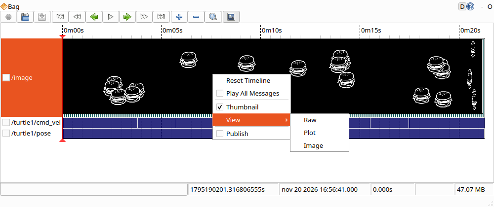
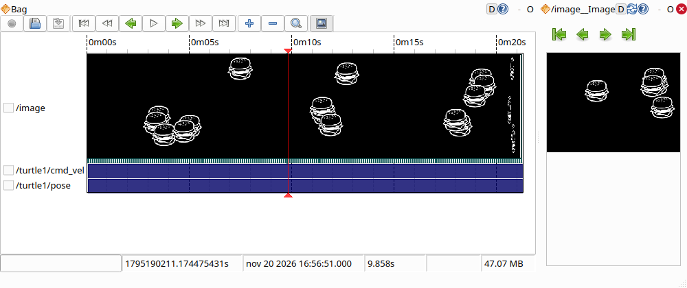
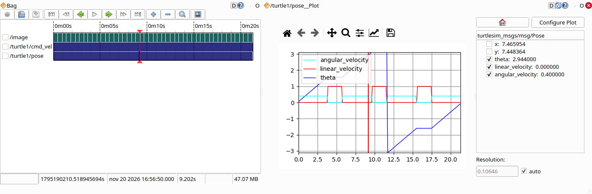

# rqt_bag_plugins

`rqt_bag_plugins` provides plugins for [rqt_bag](https://docs.ros.org/en/rolling/p/rqt_bag/), the GUI tool for displaying and replaying ROS 2 bag files.
The plugins are loaded automatically by `rqt_bag` when this package is installed.

## Usage

Launch `rqt_bag` with the bag to open:

```console
ros2 run rqt_bag rqt_bag my_bag
```

Right-click on the timeline of a topic and select a view from the `View` menu.



## Plugins

### Image

The image view displays the images of [sensor_msgs/msg/Image](https://docs.ros.org/en/rolling/p/sensor_msgs/msg/Image.html) and [sensor_msgs/msg/CompressedImage](https://docs.ros.org/en/rolling/p/sensor_msgs/msg/CompressedImage.html) topics.
The image is scaled to the size of the panel.



The plugin also draws thumbnails of the images on the timeline.
Enable them with the `Thumbnail` entry of the context menu of the topic, or with the `Toggle Thumbnails` button of the toolbar.

### Plot

The plot view displays a time series plot of the numeric fields of any message.
It uses the plot widget of [rqt_plot](https://docs.ros.org/en/rolling/p/rqt_plot/).



To plot a field, check it in the tree on the right.
Only fields of the same topic can be plotted in the same view.

Clicking on the `Configure Plot` button opens the settings of `rqt_plot`, to select the plotting backend.

By default, the plotted data is sub-sampled in time to reduce the CPU load.
To change the sampling period, uncheck `auto` in the `Resolution` section and enter a period in seconds.

## Documentation

The full documentation, including tutorials on using the views and on writing your own plugin, is in the [doc](https://github.com/ros-visualization/rqt_bag/tree/rolling/rqt_bag_plugins/doc) directory, and it is published at [docs.ros.org](https://docs.ros.org/en/rolling/p/rqt_bag_plugins/).
