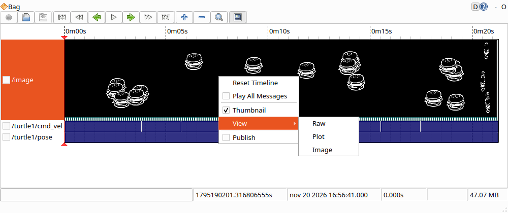
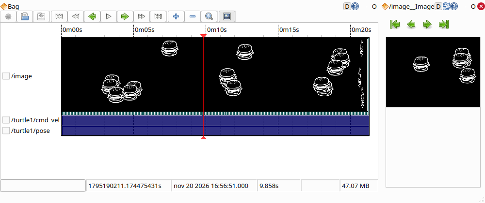
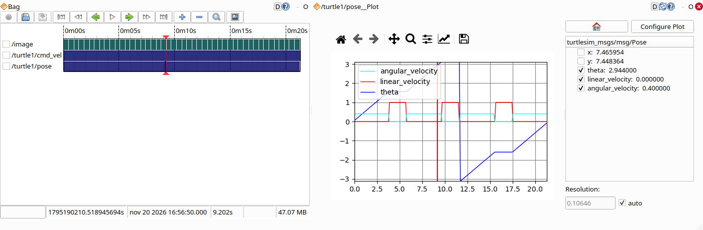

Viewing images and plotting data from a bag
-------------------------------------------

Overview
~~~~~~~~

This tutorial demonstrates how to use the image and plot views of ``rqt_bag``.
It records a bag with images and numeric data, and then it inspects the bag with ``rqt_bag``.

Prerequisites
~~~~~~~~~~~~~

This tutorial assumes you have a working knowledge of ROS 2 and of `ros2 bag <https://docs.ros.org/en/rolling/Tutorials/Beginner-CLI-Tools/Recording-And-Playing-Back-Data/Recording-And-Playing-Back-Data.html>`_.

It uses the ``image_tools`` and ``turtlesim`` packages to generate the data.
If you already have a bag with images, you can skip the first step and use your bag instead.

1. Record a bag
~~~~~~~~~~~~~~~

Open a terminal and publish some images.
In burger mode, ``cam2image`` publishes synthetic images in the ``/image`` topic, so no camera is needed:

.. code-block:: console

  $ ros2 run image_tools cam2image --ros-args -p burger_mode:=true -p frequency:=10.0

In a second terminal, start ``turtlesim``:

.. code-block:: console

  $ ros2 run turtlesim turtlesim_node

In a third terminal, make the turtle move in a square:

.. code-block:: console

  $ ros2 run turtlesim draw_square

In a fourth terminal, record the images, the velocity commands and the pose of the turtle for about 20 seconds, and then stop the recording with ``Ctrl+C``:

.. code-block:: console

  $ ros2 bag record -o my_bag --topics /image /turtle1/cmd_vel /turtle1/pose

You can now stop the other nodes.

2. Open the bag
~~~~~~~~~~~~~~~

.. code-block:: console

  $ ros2 run rqt_bag rqt_bag my_bag

``rqt_bag`` shows one row for every topic of the bag, with a mark for every message.
The red vertical line is the playhead, which you can move by clicking on the timeline.

3. Show the thumbnails
~~~~~~~~~~~~~~~~~~~~~~

Click on the ``Toggle Thumbnails`` button, the last one of the toolbar.
The row of the ``/image`` topic now shows thumbnails of the images along the timeline, which makes it easy to find the part of the bag you are interested in.

Thumbnails can also be enabled for a single topic, with the ``Thumbnail`` entry of its context menu.

4. View the images
~~~~~~~~~~~~~~~~~~

Right-click on the timeline of the ``/image`` topic and select ``View`` and then ``Image``:

A new panel is opened next to the timeline.
Click on the timeline to move the playhead: the panel shows the image at that time.

Use the buttons of the panel to go to the first, the previous, the next or the last image, or press the play button of ``rqt_bag`` to play the bag.

5. Plot the data
~~~~~~~~~~~~~~~~

Right-click on the timeline of the ``/turtle1/pose`` topic and select ``View`` and then ``Plot``.
This topic does not contain images, so the ``Image`` view is not offered.

The panel shows a tree with the fields of the message on the right, and an empty plot.
Check the ``theta``, ``linear_velocity`` and ``angular_velocity`` fields to plot them:

The plot shows how the turtle alternates between moving forward and turning.
The red vertical line of the plot follows the playhead, and the values in the tree are the ones of the message under the playhead.

To look at a part of the bag in more detail, click and drag on the time ruler above the timeline to select a region: the plot then only shows that region.
You can also zoom and pan the plot itself with the toolbar above it.

By default the plot does not use all the messages of the bag.
To plot every message, uncheck ``auto`` in the ``Resolution`` section, enter ``0`` and press ``Enter``.
