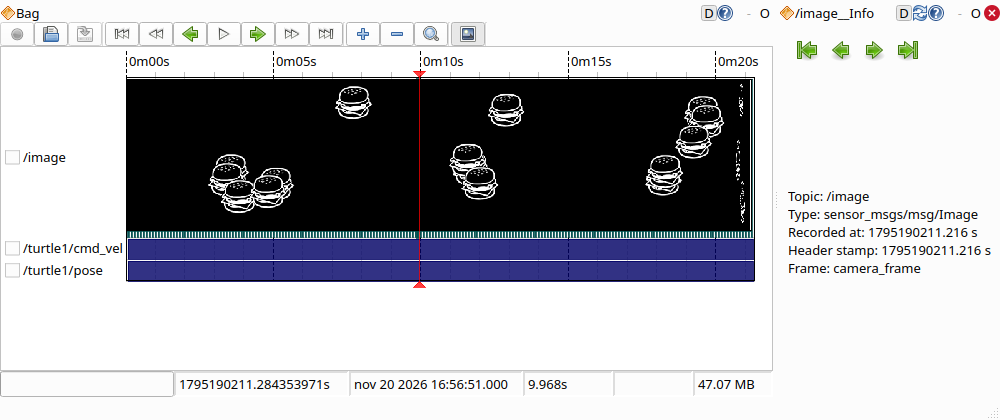

Writing an rqt_bag plugin (Python)
----------------------------------

Overview
~~~~~~~~

``rqt_bag`` can be extended with plugins that add views for specific message types, like the image and plot views of this package.
This tutorial demonstrates how to write a plugin in a new package.

As an example, the plugin of this tutorial adds an ``Info`` view, which shows the type and the time stamps of the message under the playhead.

Prerequisites
~~~~~~~~~~~~~

This tutorial assumes you have a working knowledge of ROS 2 and of Python.

If you have not done so already `create a workspace <https://docs.ros.org/en/rolling/Tutorials/Beginner-Client-Libraries/Creating-A-Workspace/Creating-A-Workspace.html>`_.

1. Create the package
~~~~~~~~~~~~~~~~~~~~~

From the ``src`` directory of your workspace, create a Python package named ``my_bag_plugins``:

.. code-block:: console

  $ ros2 pkg create --build-type ament_python --dependencies python_qt_binding rqt_bag my_bag_plugins

2. Write the view
~~~~~~~~~~~~~~~~~

A view is the widget that shows a message.
Create the file ``my_bag_plugins/info_view.py`` inside your package, with the following content:

.. code-block:: python

  from python_qt_binding.QtWidgets import QLabel

  from rqt_bag import TopicMessageView

  class InfoView(TopicMessageView):
      """Show the type and the time stamps of the message under the playhead."""

      name = 'Info'

      def __init__(self, timeline, parent, topic):
          super().__init__(timeline, parent, topic)

          self._label = QLabel('No message selected')
          parent.layout().addWidget(self._label)

      def message_viewed(self, *, entry, ros_message, msg_type_name, **kwargs):
          super().message_viewed(entry=entry)

          lines = [
              f'Topic: {self.topic}',
              f'Type: {msg_type_name}',
              f'Recorded at: {entry.timestamp / 1e9:.3f} s',
          ]
          if hasattr(ros_message, 'header'):
              stamp = ros_message.header.stamp
              lines.append(f'Header stamp: {stamp.sec + stamp.nanosec / 1e9:.3f} s')
              lines.append(f'Frame: {ros_message.header.frame_id}')
          self._label.setText('\n'.join(lines))

      def message_cleared(self):
          super().message_cleared()
          self._label.setText('No message selected')

.. code-block:: python

  class InfoView(TopicMessageView):
      """Show the type and the time stamps of the message under the playhead."""

      name = 'Info'

A view derives from ``rqt_bag.TopicMessageView``, which provides a toolbar to navigate the messages of the topic.
Views that do not need the toolbar can derive from ``rqt_bag.MessageView`` instead.

``name`` is the name of the view in the ``View`` menu.

.. code-block:: python

      def __init__(self, timeline, parent, topic):
          super().__init__(timeline, parent, topic)

          self._label = QLabel('No message selected')
          parent.layout().addWidget(self._label)

The constructor receives the timeline, the widget that contains the view and the name of the topic.
Create the widgets of the view and add them to the layout of ``parent``.

.. code-block:: python

      def message_viewed(self, *, entry, ros_message, msg_type_name, **kwargs):
          super().message_viewed(entry=entry)

``message_viewed()`` is called with the message under the playhead every time it changes.
All its arguments are given by keyword:

* ``bag``: the bag that contains the message.
* ``entry``: the entry of the message in the bag. ``entry.timestamp`` is the time at which the message was recorded, in nanoseconds.
* ``ros_message``: the deserialized message.
* ``msg_type_name``: the type of the message, for example ``sensor_msgs/msg/Image``.
* ``topic``: the name of the topic.

The ``**kwargs`` argument collects the ones that the view does not use.

.. code-block:: python

      def message_cleared(self):
          super().message_cleared()
          self._label.setText('No message selected')

``message_cleared()`` is called when there is no message to show, for example when the playhead is before the first message of the topic.

3. Write the plugin
~~~~~~~~~~~~~~~~~~~

The plugin class tells ``rqt_bag`` which view to use for which messages.
Create the file ``my_bag_plugins/info_plugin.py``:

.. code-block:: python

  from rqt_bag.plugins.plugin import Plugin

  from .info_view import InfoView

  class InfoPlugin(Plugin):

      def get_view_class(self):
          return InfoView

      def get_renderer_class(self):
          return None

      def get_message_types(self):
          return ['*']

* ``get_view_class()`` returns the class of the view.
* ``get_renderer_class()`` returns the class of a timeline renderer, which draws the messages on the timeline like the thumbnails of the image plugin.
  It derives from ``rqt_bag.TimelineRenderer``. This plugin does not have one, so it returns ``None``.
* ``get_message_types()`` returns the list of message types the plugin supports, for example ``['sensor_msgs/msg/Image']``.
  ``['*']`` makes the view available for all the topics.

4. Declare the plugin
~~~~~~~~~~~~~~~~~~~~~

``rqt_bag`` finds the plugins of the installed packages through their ``plugin.xml`` file.
Create the file ``plugin.xml`` in the root of your package:

.. code-block:: xml

  <library path=".">
    <class name="BagInfoPlugin" type="my_bag_plugins.info_plugin.InfoPlugin" base_class_type="rqt_bag::Plugin">
      <description>
        A plugin for rqt_bag for showing the type and the time stamps of a message.
      </description>
    </class>
  </library>

The ``type`` is the module and the name of the plugin class, and the ``base_class_type`` must be ``rqt_bag::Plugin``.

Export the file in the ``package.xml`` of your package, inside the ``export`` tag:

.. code-block:: xml

  <export>
    <build_type>ament_python</build_type>
    <rqt_bag plugin="${prefix}/plugin.xml"/>
  </export>

And install it by adding it to the ``data_files`` of ``setup.py``:

.. code-block:: python

      data_files=[
          ('share/ament_index/resource_index/packages', ['resource/' + package_name]),
          ('share/' + package_name, ['package.xml', 'plugin.xml']),
      ],

5. Build and run
~~~~~~~~~~~~~~~~

Build your package from the root of your workspace and source it:

.. code-block:: console

  $ colcon build --packages-select my_bag_plugins
  $ source install/setup.bash

Open a bag with ``rqt_bag``:

.. code-block:: console

  $ ros2 run rqt_bag rqt_bag my_bag

Right-click on the timeline of a topic: the ``View`` menu now contains the ``Info`` view.
Select it and click on the timeline to move the playhead:

If the view is not in the menu, look for a ``failed to load plugin`` message in the terminal, which shows the error.
