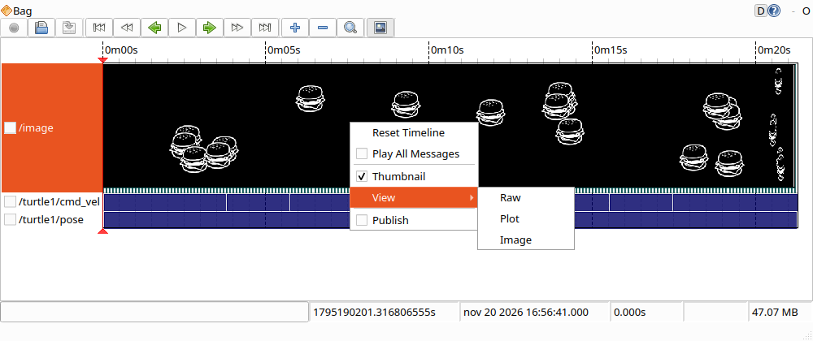
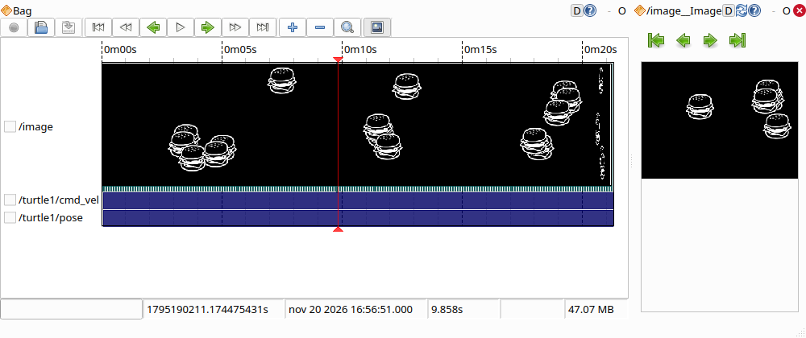
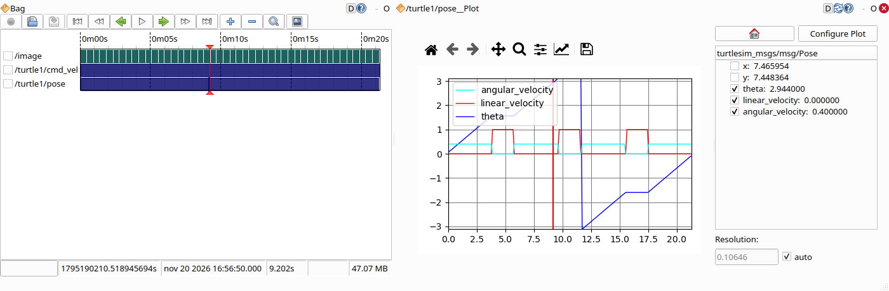

rqt_bag Plugins
===============

``rqt_bag_plugins`` provides plugins for `rqt_bag <https://docs.ros.org/en/rolling/p/rqt_bag/>`_, the GUI tool for displaying and replaying ROS 2 bag files.
The plugins add message views and timeline renderers for specific message types:

* The image plugin (see `2. Image`_) shows ``sensor_msgs/msg/Image`` and ``sensor_msgs/msg/CompressedImage`` messages, and it draws thumbnails of the images on the timeline.
* The plot plugin (see `3. Plot`_) plots the numeric fields of any message over time.

The plugins are loaded automatically by ``rqt_bag`` when this package is installed.

.. toctree::
   :maxdepth: 2

   self
   tutorials
   references
   Package information </standards>

1. Usage
--------

Launch ``rqt_bag`` with the bag to open:

.. code-block:: console

   $ ros2 run rqt_bag rqt_bag my_bag

Right-click on the timeline of a topic and select a view from the ``View`` menu.
The menu lists the views that are available for the type of the topic: ``Raw`` is part of ``rqt_bag``, and the rest are provided by plugins.

A right-click on an empty area of the timeline shows the views of all the topics instead, grouped by topic and by type.

The view is opened in a new panel, which can be moved, detached or closed like any other ``rqt`` panel.
It shows the message under the playhead (the red vertical line), so it is updated while the bag is played and when you click on the timeline.

2. Image
--------

The image view displays the images of ``sensor_msgs/msg/Image`` and ``sensor_msgs/msg/CompressedImage`` topics.

The image is scaled to the size of the panel, keeping its aspect ratio.
The buttons of the toolbar move the playhead to the first, the previous, the next and the last message of the topic.

The plugin also provides a timeline renderer, which draws thumbnails of the images along the timeline of the topic.
Enable it with the ``Thumbnail`` entry of the context menu of the topic, or for all the topics with the ``Toggle Thumbnails`` button of the toolbar.

2.1 Supported images
~~~~~~~~~~~~~~~~~~~~

``sensor_msgs/msg/Image``
  ``mono8``, ``8UC1``, ``rgb8``, ``bgr8``, ``mono16``, ``16UC1``, ``32FC1`` and the 8-bit and 16-bit Bayer encodings.

  The contrast of 16-bit and floating point images, like depth images, is stretched automatically.
  Bayer images are shown as grayscale images, without debayering them.

``sensor_msgs/msg/CompressedImage``
  The formats that `Pillow <https://pillow.readthedocs.io/en/stable/handbook/image-file-formats.html>`_ can read, which include JPEG, PNG and TIFF.
  This covers the ``compressed`` transport of ``image_transport``, and the ``compressedDepth`` transport with the PNG format.

If an image cannot be converted, an error is printed in the terminal and the thumbnails of the topic are disabled.

3. Plot
-------

The plot view displays a time series plot of the numeric fields of a message.
It is available for all the topics, and it uses the plot widget of `rqt_plot <https://docs.ros.org/en/rolling/p/rqt_plot/>`_.

To plot a field, check it in the tree on the right, which shows the message under the playhead.
Only fields of the same topic can be plotted in the same view.

* The horizontal axis is the time in seconds since the beginning of the bag, and the red vertical line is the position of the playhead.
* The plot shows the region of the bag that is selected in the timeline, or the whole bag if there is no selection.
  To select a region, click and drag on the time ruler above the timeline.
* For arrays, only the first 50 and the last 10 elements are listed.
* ``Ctrl+C`` copies the text of the selected fields to the clipboard, and ``Ctrl+A`` selects all the fields.

Some messages have additional computed fields, whose names start with ``*``:

.. list-table::
   :header-rows: 1
   :widths: 35 65

   * - Message
     - Computed fields
   * - ``builtin_interfaces/msg/Time``
     - ``*float_seconds``: the time as a floating point number of seconds.
   * - ``geometry_msgs/msg/Quaternion``
     - ``*roll(rad)``, ``*pitch(rad)``, ``*yaw(rad)``, ``*roll(deg)``, ``*pitch(deg)`` and ``*yaw(deg)``: the orientation as Euler angles.

3.1 Toolbar
~~~~~~~~~~~

The toolbar above the plot is the one of the plotting backend, to pan, zoom and save the plot.
The buttons above the tree are:

* The home button resets the view of the plot.
* ``Configure Plot`` opens the settings of ``rqt_plot``, to select the plotting backend.

3.2 Resolution
~~~~~~~~~~~~~~

By default the data is sub-sampled in time to reduce the CPU load: at most one message is plotted for every 1/200 of the time range of the plot.
To change the sampling period, uncheck ``auto`` in the ``Resolution`` section and enter a period in seconds.
The plot is refreshed with the new period.

.. note::

   Sub-sampling picks one message of every period.
   Short spikes in the data can therefore be missing from the plot: reduce the period, or select a shorter region of the bag, to see them.

4. Writing a plugin
-------------------

``rqt_bag`` can be extended with plugins for other message types.
A plugin provides a view, and optionally a timeline renderer, for a list of message types.
See the :doc:`Tutorials/Writing-A-Plugin-Python` tutorial.
